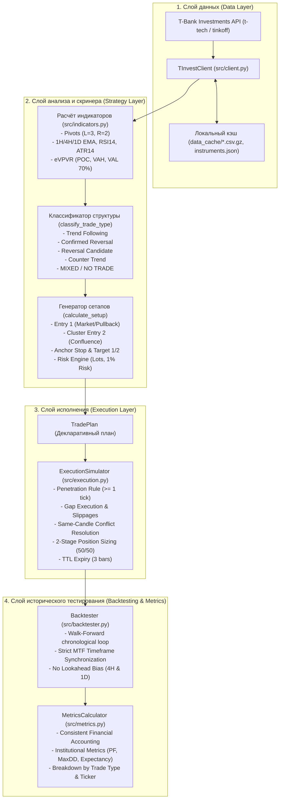

# Полная техническая документация алгоритмической торговой системы MOEX (TQBR)

Настоящий документ содержит исчерпывающее техническое описание архитектуры, алгоритмов, математических моделей, симулятора исполнения заявок и механизмов валидации алгоритмической системы поиска и тестирования сетапов на фондовом рынке Московской Биржи (режим торгов TQBR).

---

## 1. Архитектура системы и модульная структура

Система построена по принципу **строгой модульной изоляции**: логика формирования торговых идей (скринер/стратегия), модель моделирования биржевого стакана (симулятор исполнения) и финансовый учет (метрики) полностью отделены друг от друга.



### Назначение файлов проекта:
| Модуль | Файл | Ответственность |
|:---|:---|:---|
| **Клиент API** | `src/client.py` | Взаимодействие с API Т-Инвестиций, фильтрация класса TQBR, кэширование инструментов. |
| **Конфигурация** | `src/config.py` | Константы риска (1R = 1%), порогов R/R ($\ge 2.0$), буферов ATR. |
| **Индикаторы** | `src/indicators.py` | Расчёт EMA, RSI, ATR, профиля объема eVPVR (70%), подтверждённых пивотов ($L=3, R=2$). |
| **Стратегия** | `src/strategy.py` | 4-уровневая иерархия сигналов, расчёт кластерного Entry 2, защитного стопа, тейков и лотов. |
| **Отчёты** | `src/reporting.py` | Консольный вывод Rich и экспорт Markdown-отчётов по одиночным бумагам и пулу. |
| **Конфиг бэктеста** | `src/backtest_config.py` | Параметры симуляции: комиссии (0.05%), проскальзывания, TTL, флаги разрешения коллизий. |
| **Симулятор заявок** | `src/execution.py` | Полностью изолированный симулятор биржевого исполнения, лимиток, гэпов и стопов. |
| **Метрики** | `src/metrics.py` | Расчёт институциональных показателей эффективности со строгим финансовым сведением. |
| **Бэктестер** | `src/backtester.py` | Хронологический Walk-Forward цикл, MTF-синхронизация без заглядывания в будущее. |
| **CLI скринера** | `analyzer.py` / `scan.bat` | Точка входа для скрининга рынка в реальном времени. |
| **CLI бэктеста** | `run_backtest.py` / `backtest.bat` | Точка входа для запуска исторического тестирования. |

---

## 2. Алгоритм работы скринера (генерация торговых сетапов)

Скринер выполняет многофакторный структурный анализ рынка на трёх согласованных таймфреймах: **1H (рабочий/триггерный)**, **4H (промежуточный)** и **1D (старший господствующий тренд)**.

### 2.1. Индикаторная база и профиль объёма
1. **Экспоненциальные скользящие средние (EMA):**
   - 1H: EMA20 (краткосрочный импульс), EMA50 (среднесрочный баланс).
   - 4H: EMA20, EMA50 (граница среднесрочного тренда).
   - 1D: EMA20 (граница старшего тренда), EMA50.
2. **Индекс относительной силы (RSI-14):**
   - Измеряет импульс на 1H, используется в фильтрации зон перекупленности/перепроданности и боковика.
3. **Average True Range (ATR-14):**
   - Используется для адаптивных динамических буферов стопа, пробоя и минимальных расстояний между ордерами.
4. **Эмулированный профиль объёма (eVPVR):**
   - Рассчитывается на окне последних 80 часовых свечей с разбиением на 30 ценовых бинов.
   - Определяет **ePOC** (Point of Control — уровень максимального проторгованного объёма).
   - Определяет **Value Area (70% объёма)**: **VAH** (Value Area High) и **VAL** (Value Area Low).

---

### 2.2. Модель структуры рынка: Pivot Points ($L=3, R=2$)
Для исключения субъективности и эффекта заглядывания в будущее определение экстремумов структуры формализовано через пивоты с запаздывающим подтверждением:
* **Параметры:** $Left = 3$ (свечей слева), $Right = 2$ (свечей справа).
* **Pivot High (локальная вершина):**
  $$\text{High}_i > \max(\text{High}_{i-3}, \text{High}_{i-2}, \text{High}_{i-1}) \quad \text{и} \quad \text{High}_i > \max(\text{High}_{i+1}, \text{High}_{i+2})$$
* **Pivot Low (локальное дно):**
  $$\text{Low}_i < \min(\text{Low}_{i-3}, \text{Low}_{i-2}, \text{Low}_{i-1}) \quad \text{и} \quad \text{Low}_i < \min(\text{Low}_{i+1}, \text{Low}_{i+2})$$
* **Критическое правило No-Lookahead:** Пивот, сформированный на свече $i$, становится известным алгоритму **строго после закрытия свечи $i+2$**. До этого момента он считается неподтверждённым и не участвует в расчётах уровней.

---

### 2.3. Четырёхуровневая иерархия классификации сетапов (`Trade Type`)
Скринер разделяет сетапы по строгой иерархии качества:

```
[Старший тренд (4H EMA50 + 1D EMA20)]
         │
         ├── BULLISH / BEARISH (Согласованы)
         │       └── 1. Trend Following (Торговля строго по тренду)
         │
         ├── Слом структуры (Пробой пивота + 0.10 ATR)
         │       ├── Пробой + удержание/ретест ──► 2. Confirmed Reversal (Retest Confirmed)
         │       └── Пробой закрытием часа    ──► 2. Confirmed Reversal (Breakout Confirmed)
         │
         ├── Попытка разворота без пробоя пивота
         │       └── 3. Reversal Candidate (Close > EMA50 и POC, RSI >= 50, старший тренд против)
         │
         ├── Откат против тренда
         │       └── 4. Counter Trend (Контртрендовый отскок к EMA50)
         │
         └── Неопределенность / боковик
                 └── MIXED / NO TRADE (Флэт |abs(P - EMA50)| < 0.40 ATR, RSI 45-55, либо конфликт 1D/4H)
```

1. **`Trend Following` (Приоритет 1):** Направление сетапа совпадает со старшим трендом (для Long: цена выше 4H EMA50 и 1D EMA20), на 1H цена выше EMA50 или RSI $\ge 40$.
2. **`Confirmed Reversal` (Приоритет 2):** Слом структуры подтверждён закрытием часовой свечи за порогом пробоя ($\text{Pivot High} + 0.10 \times \text{ATR}_{1H}$ для Long). Разделяется на:
   - `Breakout Confirmed` — импульсный пробой закрытием 1H.
   - `Retest Confirmed` — возврат цены в зону пробоя в течение 3 свечей без закрытия под пивотом и последующее возобновление движения.
3. **`Reversal Candidate` (Приоритет 3):** Предварительный сетап против старшего тренда при локальном импульсе: цена закрепилась выше 1H EMA50 и ePOC, RSI $\ge 50$, но пивот структуры ещё не пробит. Требует обязательного подтверждения.
4. **`Counter Trend` (Приоритет 4):** Глубокий откат против старшего тренда, попытка поймать возврат к средней.
5. **`MIXED / NO TRADE` (Блокировка):**
   - Узкая консолидация около 1H EMA50: $|P - \text{EMA50}| < 0.40 \times \text{ATR}_{1H}$ при RSI в диапазоне $45..55$.
   - Противоречие старших таймфреймов (1D Bullish при 4H Bearish) без явного импульса. Сетап принудительно блокируется со статусом `SKIP`.

---

### 2.4. Двухэтапный вход: Entry 1 и кластерный Entry 2

```
                       ЦЕНОВАЯ СТРУКТУРА СЕТАПА (LONG)
                       
   ▲ Цена
   │
   │  ┌──────────────────────────────────────────────┐
   │  │ Take Profit 2 (Swing Target 2: VAH / Pivot)  │
   │  └──────────────────────────────────────────────┘
   │
   │  ┌──────────────────────────────────────────────┐
   │  │ Take Profit 1 (Target 1: 50% позиции)        │
   │  └──────────────────────────────────────────────┘
   │
───┼──► Entry 1 (Текущая цена / EMA20 / POC) ───────── (50% объёма)
   │    │
   │    ▼ [Буфер >= 0.20 ATR]
   │  ┌──────────────────────────────────────────────┐
   │  │ Entry 2: Кластер поддержек                   │ ◄── (50% объёма)
   │  │ Confluence: VAL 70%, Pivot Low, 1H EMA50     │
   │  └──────────────────────────────────────────────┘
   │    ▲ [Буфер >= 0.20 ATR]
   │    │
───┼──► Anchor Stop (Структурный уровень защиты)
   │    │
   │    ▼ [Буфер 0.60 ATR]
   │  ┌──────────────────────────────────────────────┐
   │  │ Физический Stop-Loss в стакане               │
   │  └──────────────────────────────────────────────┘
```

1. **Entry 1 (50% планового объёма):**
   - Для Long: $\min(\text{Current Price}, \max(\text{EMA20}_{1H}, \text{POC80}_{1H}))$.
   - Обеспечивает немедленное участие в случае резкого продолжения движения без глубокого отката.
2. **Entry 2 (50% планового объёма) — алгоритм кластеризации (Confluence):**
   - Осуществляет поиск уровней интереса строго внутри диапазона:
     $$[\text{Anchor Stop} + 0.20 \times \text{ATR}_{1H}, \quad \text{Entry 1} - 0.20 \times \text{ATR}_{1H}]$$
   - Кандидаты ранжируются по весам:
     * VAL 70% (профиль объёма) — вес 2.5
     * 1H Pivot Low — вес 2.5
     * 1H Swing Low (минимум за 20 свечей) — вес 2.0
     * 1H EMA50 — вес 2.0
     * 4H EMA20 — вес 1.5
     * 1H POC — вес 1.5
   - Алгоритм группирует близкие уровни (расстояние $< 0.35 \times \text{ATR}_{1H}$) в кластеры и вычисляет взвешенный центр масс.
   - **Защита от сжатия диапазона:** Если ширина доступного коридора $< 0.40 \times \text{ATR}_{1H}$, сетап помечается как `INVALID_ENTRY_RANGE` и отменяется, предотвращая опасное сближение ордеров со стопом.

---

### 2.5. Модель выходов: Anchor Stop, Take Profit 1 и Take Profit 2
* **Anchor Stop (Структурный якорь):**
  - Для Long: выбирается как максимальная из подтверждённых структурных опор ниже входа ($\text{VAL}_{1D}$, $\text{EMA50}_{4H}$, $\text{Swing Low}_{1D}$, $\text{Pivot Low}_{1H}$).
  - **Фактический Stop-Loss:** выставляется за якорь с запасом на рыночный шум:
    $$\text{Stop-Loss} = \text{Anchor Stop} - 0.60 \times \text{ATR}_{1H}$$
* **Take Profit 1:** Первая цель для фиксации 50% набранной позиции. Рассчитывается как сопротивление старшей структуры ($\text{EMA50}_{4H}$, $\text{VAH}_{1H}$, либо ближайший Pivot High).
* **Take Profit 2:** Вторая цель для полного закрытия остатка (Swing runner) на ключевом экстремуме старшего таймфрейма.
* **Фильтр Risk/Reward (R/R):**
  - Отношение средней прибыли к риску на акцию:
    $$RR = \frac{0.5 \times (TP_1 - Entry_{avg}) + 0.5 \times (TP_2 - Entry_{avg})}{Entry_{avg} - Stop}$$
  - Сетапы с $RR < 2.0$ автоматически отклоняются (`SKIP (R/R < 2.0)`).
* **Расчет позиции (Risk Management):**
  - Риск на сделку строго ограничен фиксированной суммой (по умолчанию 1 000 ₽, что составляет 1.0% от капитала 100 000 ₽).
  - Общее количество акций и распределение по лотам:
    $$\text{Total Shares} = \left\lfloor \frac{\text{Risk Rub}}{Entry_{avg} - Stop} \right\rfloor_{\text{кратно } Lot}$$
    $$\text{Shares}_{E1} = \frac{\text{Total Shares}}{2}, \quad \text{Shares}_{E2} = \frac{\text{Total Shares}}{2}$$

---

## 3. Модель исполнения ордеров (`src/execution.py`)

Модуль исполнения функционирует как **автономный биржевой симулятор**. Он принимает готовый объект `TradePlan` и сырые свечи $OHLCV$, не имея доступа к индикаторам и стратегиям.

### 3.1. Правило проникновения за уровень (Penetration Rule)
Касание ценой лимитного уровня верхним/нижним краем экстремальной тени **не гарантирует исполнение заявки в реальном стакане**:
* **Для заявки на покупку (BUY LIMIT):**
  - Условие исполнения: $\text{Low} < \text{Limit Price} - (\text{Ticks} - 1) \times \text{Step}$,
  - **Либо:** $\text{Low} == \text{Limit Price}$ при условии, что свеча закрылась на/ниже уровня ($\text{Close} \le \text{Limit Price}$).
* Простое касание тени с мгновенным отскоком и закрытием выше лимита заявку **не исполняет**.

---

### 3.2. Моделирование ценовых разрывов (Gaps) и проскальзываний
* **Гэп на входе (Buy Limit):** Если свеча открывается гэпом вниз ниже лимитной цены ($Open < Limit$), исполнение рассчитывается **по цене открытия $Open$ с добавлением штрафного гэп-проскальзывания**, а не по завышенной цене лимитки:
  $$\text{Fill Price} = Open \times (1 + \text{Slippage}_{gap})$$
* **Гэп на стопе (Stop-Loss):** Если рынок открылся гэпом вниз за уровнем стопа ($Open < Stop$), позиция ликвидируется по цене открытия $Open$ со стоповым проскальзыванием:
  $$\text{Exit Price} = Open \times (1 - \text{Slippage}_{stop})$$
* **Гэп на тейке (Take Profit):** Если рынок открылся гэпом вверх выше тейка ($Open > TP$), прибыль фиксируется по цене открытия гэпа с премией в пользу трейдера:
  $$\text{Exit Price} = Open \times (1 - \text{Slippage}_{take})$$

---

### 3.3. Разрешение коллизий внутри одной OHLCV-свечи (Same-Candle Ambiguity)
Внутри часовой свечи порядок движения цены [Open $\rightarrow$ High $\rightarrow$ Low $\rightarrow$ Close] неизвестен. Симулятор применяет консервативные правила:
1. **Entry 1 vs Stop-Loss на свече активации:** Считается, что Stop-Loss сработал первым. План переходит в статус `CANCELLED_HIT_STOP_ON_ENTRY`, позиция не открывается, убыток не фиксируется.
2. **Stop-Loss vs Take Profit на одной свече:** Всегда принимается наихудший для трейдера сценарий — срабатывание Stop-Loss.
3. **Entry 2 vs Take Profit 1 на одной свече:** Считается, что импульс сначала достиг цели TP1. Заявка Entry 2 немедленно отменяется, а прибыль по TP1 фиксируется только на объём первого входа (Entry 1).
4. **Импульсный TP1 на свече первого входа:** Если на свече активации Entry 1 цена достала TP1 (а Entry 2 не коснулась), симулятор немедленно фиксирует 50% прибыли, переводит план в `ACTIVE_PARTIAL_TP1` и отменяет Entry 2.

---

### 3.4. Контроль времени жизни заявок (Time-To-Live, TTL)
* Лимитные заявки Entry 1 и Entry 2 активны ровно **3 часовые свечи** после закрытия сигнального бара $t$.
* Если по истечении 3 свечей проникновение за уровень не произошло, заявки аннулируются (`EXPIRED_NO_FILL`), освобождая капитал.
* Если Entry 1 был исполнен, а Entry 2 не исполнился в течение 3 свечей, лимитка Entry 2 снимается, и позиция удерживается в объёме 50%.

---

## 4. Хронологический бэктестер (`src/backtester.py`) и защита от Lookahead Bias

Бэктестер реализует строгий пошаговый проход (Walk-Forward) от прошлого к будущему.

```
ХРОНОЛОГИЧЕСКИЙ ШАГ НА СВЕЧЕ t (Время начала = T_t, закрытие = T_close):

[Шаг 1: Исполнение на текущей свече t]
   │  Свеча t (Open, High, Low, Close, Volume) передаётся в ExecutionSimulator.
   │  Обрабатываются активные позиции и лимитные заявки, выставленные на свечах <= t-1.
   │  Обновляется кривая капитала: Capital += Delta(Gross PnL) - Delta(Commissions).
   ▼
[Шаг 2: Генерация нового сетапа на закрытии свечи t]
   │  (Выполняется только если нет активного плана по данному тикеру)
   │  Формируется исторический срез индикаторов:
   │  - 1H: строго свечи <= t включительно (последняя свеча t закрыта!).
   │  - 4H: строго свечи, где (Time_start + 4h <= T_close).
   │  - 1D: строго свечи, где (Date_start < Date_t).
   │  Вызов strategy.calculate_setup().
   ▼
[Шаг 3: Активация нового плана]
      Если сгенерирован ACTIVE-сетап, создаётся TradePlan с created_bar_idx = t.
      СТРОГОЕ ПРАВИЛО: данный план начнёт проверяться на исполнение ТОЛЬКО со свечи t+1!
```

### Доказательство отсутствия Lookahead Bias на старших ТФ:
1. **Таймфрейм 4H:**
   - Интервалы в API T-Bank начинаются в `00:00, 04:00, 08:00, 12:00, 16:00, 20:00 UTC`.
   - Свеча 4H, начавшаяся в 12:00, закрывается ровно в 16:00.
   - На часовых свечах 12:00, 13:00, 14:00 (закрывающихся в 13:00, 14:00, 15:00) условие $T_{4h} + 4\text{ч} \le T_{1h\_close}$ ложно.
   - Эта свеча попадает в расчёт индикаторов **только на закрытии 15-часовой свечи (в 16:00)**.
2. **Таймфрейм 1D:**
   - Дневная свеча имеет дату $D$.
   - На протяжении всех часовых свечей дня $D$ (с 07:00 до 23:50 МСК) условие `df_1d["time"].dt.date < curr_time.date()` строго исключает дневную свечу текущего дня.
   - Алгоритм видит только завершённые дневные свечи до дня $D-1$ включительно. Сегодняшняя дневная свеча становится видна алгоритму только в 00:00 следующего торгового дня.

### Принудительное закрытие в конце бэктеста:
Если к последней свече тестируемого периода позиция остаётся открытой, вызывается метод `close_position_at_market()`:
* Позиция закрывается по фактической цене `Close` последней свечи.
* Применяется стандартная биржевая комиссия.
* Штрафное проскальзывание стопа (0.05%) **не начисляется** (слиппедж = 0.0).
* Статус плана переходит в `CLOSED_END_OF_BACKTEST`. В метриках данный выход учитывается отдельно и **не завышает число Stop-Loss выходов**.

---

## 5. Финансовый учёт и метрики (`src/metrics.py`)

В системе реализована единая математически выверенная система сходимости финансовых результатов.

### 5.1. Формулы валового и чистого PnL
1. **Валовый курсовой результат (Gross PnL):**
   - Для LONG:
     $$\text{Gross PnL} = (\text{Exit Price} - \text{Entry Price}) \times \text{Shares}$$
   - Для SHORT:
     $$\text{Gross PnL} = (\text{Entry Price} - \text{Exit Price}) \times \text{Shares}$$
   Накапливается в `Position.realized_pnl` при каждой сделке фиксации (TP1, TP2, Stop, Market Close).
2. **Учёт комиссий:**
   - При каждом входе: $\text{Comm}_{in} = \text{Fill Price} \times \text{Shares} \times 0.0005$ (0.05%).
   - При каждом выходе: $\text{Comm}_{out} = \text{Exit Price} \times \text{Shares} \times 0.0005$ (0.05%).
   - Суммарная комиссия накапливается в `Position.commission_paid`.
3. **Чистый результат (Net PnL):**
   $$\text{Position.net\_pnl} = \text{Position.realized\_pnl} - \text{Position.commission\_paid}$$

### 5.2. Абсолютная сходимость баланса
Для любого бэктеста соблюдается фундаментальное равенство:
$$\mathbf{\text{Net Profit} = \text{Gross Profit} - \text{Gross Loss} - \text{Total Commissions}}$$
$$\mathbf{\text{Final Capital} = \text{Initial Capital} + \text{Net Profit}}$$

### 5.3. Институциональные показатели
* **Profit Factor (PF):** $\frac{\text{Gross Profit}}{\text{Gross Loss}}$.
* **Win Rate (%):** $\frac{\text{Количество прибыльных сделок (Net PnL} > 0)}{\text{Всего исполненных сделок}} \times 100\%$.
* **Payoff Ratio (Win/Loss):** $\frac{\text{Средняя прибыль (Avg Win)}}{\text{Средний убыток (Avg Loss)}}$.
* **Математическое ожидание (Expectancy):** Чистый ожидаемый доход на одну сделку с учётом вероятностей и комиссий:
  $$\text{Expectancy} = (WR \times \text{Avg Win}) - (LR \times \text{Avg Loss}) - \text{Avg Commission}$$
* **Максимальная просадка (Max Drawdown):** Вычисляется по непрерывной кривой капитала (`equity_curve`) от исторического пика:
  $$\text{Max DD (₽)} = \max_{t} (\text{Peak}_t - \text{Equity}_t), \quad \text{Max DD (\%)} = \max_{t} \left(\frac{\text{Peak}_t - \text{Equity}_t}{\text{Peak}_t}\right) \times 100\%$$
* **Recovery Factor:** $\frac{\text{Net Profit}}{\text{Max DD (₽)}}$.

---

## 6. Тестовое покрытие (Unit & Audit Test Suites)

Система покрыта двумя независимыми тестовыми наборами (всего **23 автоматических теста**).

### Набор 1: Аудит логики стратегии (`tests_audit_step1.py` — 6 тестов)
1. `test_01_pivot_delay`: Подтверждение пивотов строго через 2 закрытые свечи ($i+2$).
2. `test_02_is_complete_filter`: Исключение формирующихся (незакрытых) свечей из расчёта индикаторов.
3. `test_03_breakout_vs_retest`: Строгое разделение `Breakout Confirmed` и `Retest Confirmed`.
4. `test_04_consolidation_filter`: Блокировка флэта и конфликта 1D/4H статусом `MIXED / NO TRADE`.
5. `test_05_entry2_defensive_buffers`: Защитные буферы 0.20 ATR для Entry 2 и отмена при сжатии диапазона.
6. `test_06_short_mirror_logic`: Зеркальная работа всей логики для шортов.

### Набор 2: Симулятор исполнения и синхронизация (`tests_backtest.py` — 17 тестов)
1. `test_01_penetration_rule`: Касание без пробития не исполняет лимитку; пробитие на 1 тик — исполняет.
2. `test_02_gap_down_execution`: Исполнение на гэпе вниз рассчитывается от цены `Open` со штрафом.
3. `test_03_same_bar_conflict_entry_vs_stop`: Одновременный стоп и вход на одной свече отменяет план без открытия сделки.
4. `test_04_same_bar_conflict_entry2_vs_tp1`: Одновременный TP1 и Entry 2 отменяет Entry 2 в пользу TP1.
5. `test_05_same_bar_conflict_stop_vs_tp`: Одновременный стоп и тейк закрывает сделку по худшему исходу (Stop-Loss).
6. `test_06_ttl_expiration`: Истечение 3 баров переводит неисполненную заявку в `EXPIRED_NO_FILL`.
7. `test_07_entry2_cancellation_after_tp1_on_separate_bars`: Взятие TP1 на отдельной свече навсегда отменяет Entry 2.
8. `test_08_full_two_take_cycle`: Полный цикл 2 входов и 2 тейков.
9. `test_09_same_bar_entry1_and_tp1`: Мгновенное исполнение TP1 на свече входа Entry 1.
10. `test_10_financial_accounting_consistency`: Проверка сходимости формул PnL и кривой капитала.
11. `test_11_timeframe_synchronization_no_lookahead`: Изоляция 4H-свечи до её фактического закрытия.
12. `test_12_end_of_backtest_market_close`: Рыночный выход в конце бэктеста без стопового проскальзывания.
13. `test_13_short_direction_gross_and_net_pnl_with_commissions`: Проверка инверсии знака формулы шорта.
14. `test_14_multiple_entries_weighted_average_pnl`: Расчёт средневзвешенной цены двух входов и PnL выхода.
15. `test_15_gap_through_stop_loss_and_take_profit`: Гэп через стоп штрафует, гэп через тейк даёт бонус.
16. `test_16_partial_take_and_trailing_stop_loss`: Частичное закрытие 50% и выбивание остатка по стопу.
17. `test_17_calendar_date_1d_synchronization`: Строгая изоляция дневных свечей по календарной дате.

---

## 7. Руководство оператора (Команды и использование)

### 7.1. Запуск скринера в реальном времени
```powershell
# Интерактивное меню скринера
.\scan

# Анализ одиночной акции (направление выбирается автоматически по тренду)
.\scan SBER
.\scan MAGN long
.\scan LKOH short

# Пакетный скрининг по всем ликвидным бумагам корзины
.\scan all
.\scan all long
```

### 7.2. Запуск исторического бэктестера
```powershell
# Бэктест одного тикера на 60 дней (депозит 100 000 ₽, риск 1 000 ₽)
.\backtest SBER

# Настройка горизонта тестирования (например, 180 дней)
.\backtest SBER --days 180

# Бэктест с принудительным обновлением кэша котировок из API
.\backtest SBER --days 90 --reload

# Портфельный бэктест по всей корзине акций
.\backtest all --days 60
```

### 7.3. Запуск верификационных тестов
```powershell
# Юнит-тесты симулятора и бэктестера (17 тестов)
.\.venv\Scripts\python.exe -m unittest tests_backtest.py -v

# Комплексный аудит логики стратегии и пивотов (6 тестов)
.\.venv\Scripts\python.exe tests_audit_step1.py
```
